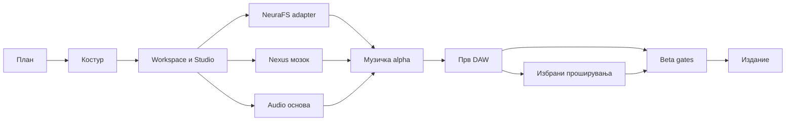

# Фази, зависности и контролни точки

Нема календарско ветување пред потврден опфат и измерен развоен пакет. Фазата се затвора со докази, не со количество код. Сите функционални фази подолу се планирани; завршени се поставувањето и документарниот преглед, не самите функции.

| Фаза | Пакети | Резултат | Зависност и услов за излез |
|---|---|---|---|
| P0 — Слика и договори | PLAN | Master план, граници, roadmap, checklist | Кориснички преглед на целината; отворените одлуки имаат deadline. |
| P1 — Костур | FRAME / WP-001 | Runtime, contracts, registry, lifecycle, diagnostics, fake demo | Договорениот костур работи и failure/cleanup тестовите поминуваат. |
| P2 — Проекти и Studio основа | WORK, UI | Workspace со верзии/одлуки; мала заедничка UI обвивка | P1. Project create/open/save/reopen; UI state се обновува од services. |
| P3 — NeuraFS граница | NFS | Read-only audit/baseline, избрана ревизија, минимален adapter | P1; P2 project contracts. Standalone baseline и adapter contract тестови. Без автоматски merge. |
| P4 — Nexus мозок | CORE | ModelPort, еден реален provider, session/context/memory, tool loop | P1 и P2. P3 не го блокира fake/local metadata развојот; alpha интеграцијата бара проверен adapter. |
| P5 — Аудио основа | AUDIO | Decode/validation, measurement, offline jobs, playback/render | P2 и storage contract; P3 за NeuraFS path. Мерења на познати fixtures; нема фиктивно слушање. |
| P6 — Музичка alpha | MUSIC | Една договорена MIDI/музичка варијанта и реален A/B preview со проектна меморија | P4+P5 и потребниот P3 adapter. Корисникот демонстрира цел тек со свој тест материјал. |
| P7 — Прв DAW | DAW | Еден connector со ограничен read/preview/write опфат | P6; избран DAW и потврдена API површина. Проверка на ревизии, deјства, undo/rollback каде што се достапни. |
| P8 — Проширување на мозокот и музиката | EXT | Поголеми tasks, taste feedback, повеќе алатки и евентуално генератори/live input | Прифатен P6/P7 тек. По една корисна способност со посебна чек-листа. |
| P9 — Зацврстување и beta | QA | NAS recovery, permissions, jobs, migrations, load и cross-platform parity | Работи континуирано од P1; финална beta gate по избраниот опфат од P7/P8. |
| P10 — Издание | REL | Versioned installers/packages, upgrade/rollback, упатства и support bundle | P9 gates и release checklist. Проверена инсталација на поддржаните платформи. |

## Зависности без непотребно чекање

Разгранувањето прикажува независни зависности, не овластување за автоматски паралелни агенти. Тестови, diagnostics и platform smoke проверки почнуваат со P1; не се одложуваат до P9.

## Предложени ознаки на испораки

- M1 / skeleton milestone: runtime demo, без AI тврдења.
- M2 / workspace milestone: проект што се отвора, зачувува и продолжува во заеднички UI.
- M3 / intelligence milestone: реален модел, проверлива project memory и реален tool result.
- M4 / music alpha: реална анализа + уредлив музички резултат + слушлив preview + зачуван избор.
- M5 / DAW beta: прв проверен DAW connector и избрани platform/reliability gates.
- M6 / прво стабилно издание: договорен опфат, verified packages и јасни limitations.

Верзиите се доделуваат при испорака; scaffold ознаката 0.1.0 сама по себе не значи дека M1 е завршен.

## Одлуки со момент кога мора да се решат

| Одлука | Кога | Што правиме додека е отворена |
|---|---|---|
| Минимален runtime contract/config и compatibility правило | Пред имплементација во WP-001 | Конкретен предлог е во пакетот; нема избор на HTTP framework. |
| UI toolkit, fonts/design tokens и поддржани OS верзии | Рано P2, пред стабилизирање на UI | P1 има CLI diagnostics. Prototype на трите платформи пред тврдење за паритет. |
| Metadata backend, локален/NAS модел и single-writer конфликт | P2 пред трајни проекти | Fake backend само за контрактни тестови; изборот се бележи со ADR. |
| Авторитативна NeuraFS ревизија и интеграциски API | Пред P3 adapter промени | Оригиналите се читаат, не се merge-ираат. |
| Model provider, hardware budget и audio egress политика | Пред реален P4 provider | Fake ModelPort за wiring; нема испраќање приватно аудио. |
| Прва музичка задача и reference/renderer | Пред P6 | 8–16 такта MIDI/audio demo е предлог, не потврден feature. |
| Прв DAW, верзија и дозволени дејства | Пред P7 | Offline import/export и preview остануваат независна патека. |
| Performance цели и прифатливо оптоварување | По pilot од соодветната фаза, пред beta | Се собираат реални мерења; нема измислен SLA. |

## Што одложуваме ако нешто блокира

Недостапен модел не го блокира runtime-от; непознат DAW API не ја блокира offline музичката alpha; недостапен NAS се прикажува како статус и не дозволува лажно успешен write. Недостапна Linux/macOS околина дозволува Windows развој, но го блокира тврдењето дека тие платформи се проверени за издание.
