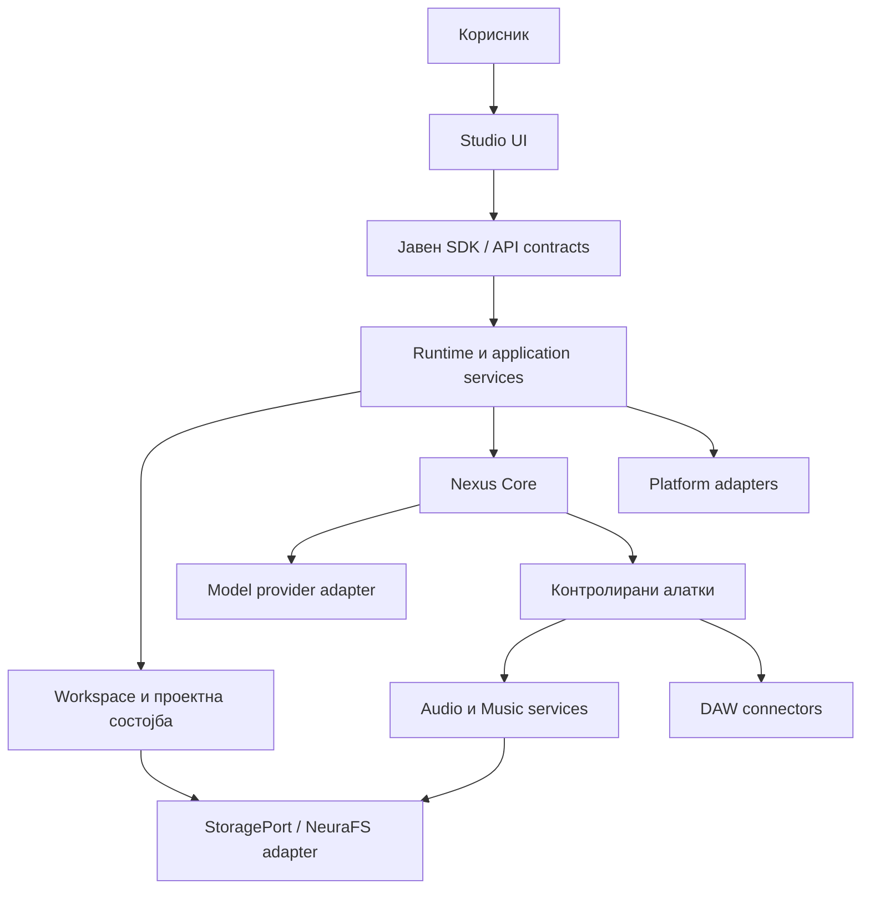

# Системска архитектура и граници

Статус: предлог за цел систем; фазите ја одредуваат реалната имплементација.

## Поврзување

Стрелките се логички повици. Runtime-от е composition root и lifecycle coordinator; не мора секој повик да минува низ централен message broker. Modules зависат од contracts, а не од туѓи внатрешни пакети. SDK се користи за UI/client границата; core-to-core повици одат преку вбризгани ports. HTTP transport е adapter, не задолжителен внатрешен слој.

## Топологија по ред

- **Костур:** една локална Python runtime инстанца и in-process ports. Нема мрежен listener или реални credentials.
- **Прва alpha:** UI/control процес и одделни worker процеси каде што модел, render или plugin тоа го бараат. Точната граница се избира со ADR, не со однапред зададен број сервиси.
- **NAS/remote:** storage или service connector со timeout, credentials и failure semantics откако NeuraFS површината е проверена. Разликуваме NAS споделена папка од мрежен NeuraFS сервис; тоа не се исти топологии.
- **Повеќе корисници:** подоцнежен посебен опфат. Раната desktop alpha е предложена за еден активен writer по проект, со експлицитно заклучување/конфликт, наместо претпоставена соработка.

## Сопственост на податоци

| Податоци | Авторитативен сопственик | Правило |
|---|---|---|
| Project manifest, brief, сесии и ревизии | Workspace | Стабилни IDs, schema version, migrations и versioned updates. |
| Аудио/MIDI/assets и renders | Storage преку договорен adapter | Оригиналите се непроменливи за предложените текови; нова обработка создава нов артефакт. |
| Прифатени одлуки и извори | Workspace memory repository | Nexus пристапува преку MemoryPort; не е втор паралелен project DB. |
| Model cache и привремен context | Nexus/provider worker | Може да се обнови; не е единствен извор на корисничка одлука. |
| Module status и job state | Runtime/jobs | Не се меша со трајни лични факти или со diagnostics log. |
| OS credentials | Credential adapter | Не се запишуваат во project manifest, prompt log или Git. |
| DAW проект | Избраниот DAW | Connector чита snapshot/revision; Studio не ја присвојува сопственоста на project format. |

NeuraFS е storage производ; конкретните операции и guarantees ќе се запишат по преглед. Не му припишуваме трансакции, semantic search, versions или MIDI анализа без докази. Metadata repository може да користи посебен локален backend зад contract ако NeuraFS не го нуди потребното.

## Модел на артефакт

Минимално: artifact_id, project_id, revision, вид, source IDs, content hash кога е применливо, location reference, generator/tool version, creation time, lifecycle status. За аудио: sample rate, channels, sample count/duration. За MIDI: PPQ/timebase, tempo map, meter и track/note структура. Derived artifact ја бележи врската со изворот и употребените параметри. „READY“ значи артефактот е валидиран и достапен, не само дека моделот изговорил URL.

## Модел на задача и дејство

Предложено → валидирано → дозволено → queued/running → succeeded/failed/cancelled. ToolResult содржи статус, outputs, error code и correlation_id. Retry се користи само каде што е безбедно; по timeout на write прво се проверува исходот. Idempotency и прекин среде извршување се дефинираат по операција. UI не прикажува успех пред потврда.

## Грешки и дозволи

Runtime идентификува principal и scope; моделот и надворешни датотеки не доделуваат доверба. Module/capability registration е експлицитна. Непознати plugins не се auto-import-ираат од произволни папки. Предлозите од моделот се валидираат како недоверливи структурирани податоци. Дозволите за destructive actions, надворешно испраќање и промени во DAW се дефинираат во договорениот пакет, без повторни прашања за веќе овластени рутински дејства.

## Python и real-time граница

Python ги води runtime-от, мозокот, jobs, APIs и shared UI каде што избраниот toolkit дозволува. Audio callback не чека LLM, NAS, UI или долга Python задача. Native DSP/bridge е оправдан исклучок зад port. Во ран offline MVP не се ветува нисколатентен live audio engine.

## NAS и recovery

Предлог: активни кешови, model files и temporary renders да можат да бидат локални; корисникот избира project/storage локација. Hardcoded Z: не влегува во runtime. Се тестираат offline share, permission denied, прекин на запис и застарена project revision. Project DB/locking и NAS filesystem guarantees се проверуваат пред избор на backend; не претпоставуваме дека локален database режим е безбеден на секое network share. Recovery не препокрива понова корисничка ревизија.

## Верзионирање

Module version и contract/schema version се различни. Breaking contract промена бара major compatibility одлука. Public API почнува со договорена v1 шема кога ќе се воведе transport; runtime skeleton користи минимален compatibility механизам. Секоја интеграција ја бележи точната поддржана ревизија на NeuraFS/model/DAW adapter. Нема молчелив upgrade на проектната шема.
